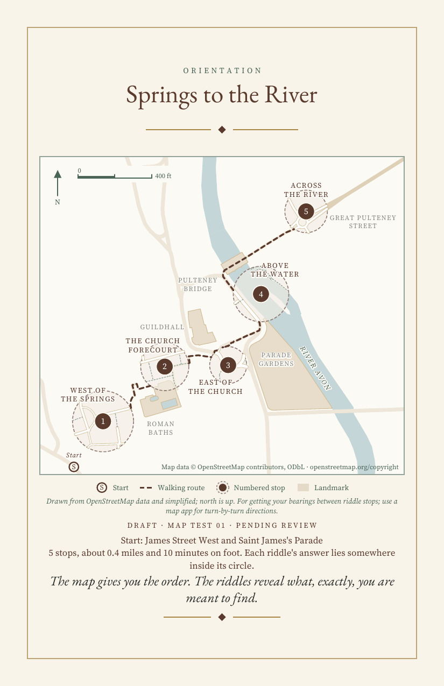
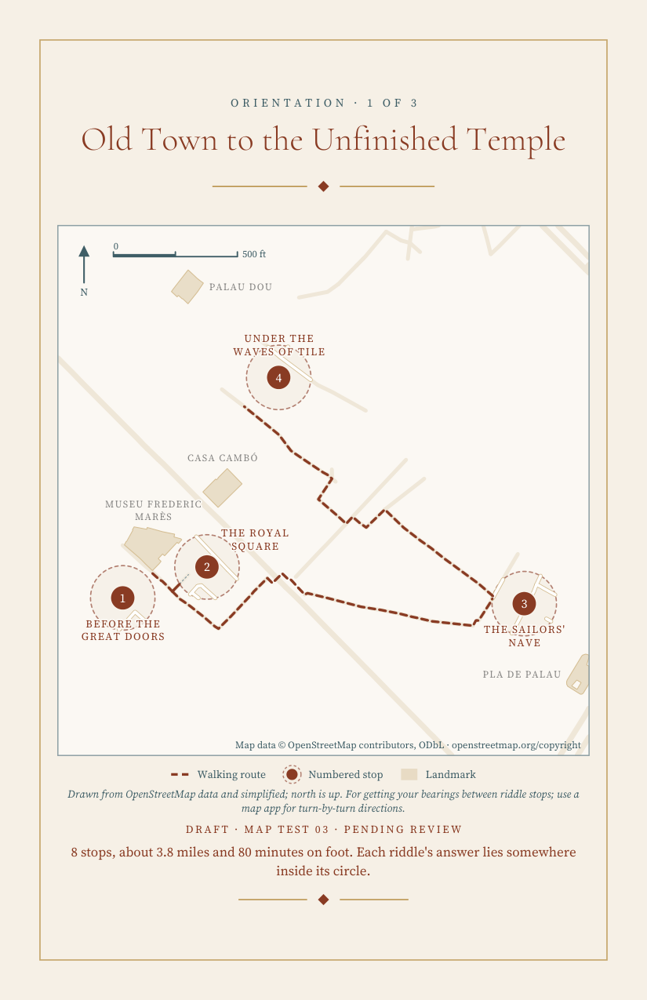

# Treasure hunt chapbook generator

A chapbook here is a small stitched booklet, half-letter size, for a walking treasure hunt through a city. The walking order is given; the challenge is a riddle at each stop that can only be solved by standing there and looking. Answers sit behind a spoiler divider at the back, with sourced facts and credited photographs.

This repository holds the generator: a skill that interviews the author about a place and a theme, references for writing riddles and pages, and Python scripts that render the booklet and its trail map. It does not hold finished hunts.

## Status

Draft, work in progress. The map, sourcing and riddle-review stages are complete and tested. The language, instruction and layout stages are still being developed, so the full-booklet pipeline should be read as a working baseline, not a finished tool. Nothing here has been through a final editorial review.

The three map tests are fixtures: they exist to prove the generator reproduces the same map from the same inputs, and to catch regressions. They are not published hunts.

## What's here

| Path | Contents |
| --- | --- |
| `chapbook_skill/SKILL.md` | The procedure: interview, research, map, spec, render, inspect |
| `chapbook_skill/references/` | Interview script, craft rules for riddles and pages, spec schema |
| `chapbook_skill/scripts/engine.py` | Page layout for the whole booklet |
| `chapbook_skill/scripts/mapgen.py` | Trail map generator (schema v2) |
| `chapbook_skill/scripts/build_map.py` | Render a map spec on its own, with a reproducibility record |
| `chapbook_skill/scripts/build_chapbook.py` | Render a full booklet spec |
| `chapbook_skill/scripts/fetch_osm.py` | Fetch and cache OpenStreetMap data with a hashed manifest |
| `chapbook_skill/scripts/provenance.py` | Source and photograph records: every answer-page claim cites a source id, every image a licence record |
| `chapbook_skill/scripts/verify_provenance.py` | Live checks before a build: source URLs fetched, Commons licences and authors compared, image files hashed |
| `chapbook_skill/scripts/riddles.py` | Riddle review: rubric, locating scan on hints, cold-solver report |
| `chapbook_skill/scripts/riddle_pages.py` | Prints the cold-solver packet (riddle pages and map text only) and its report skeleton |
| `chapbook_skill/templates/` | Example booklet spec and example map spec |
| `chapbook_skill/assets/fonts/` | Six OFL-licensed fonts (Cormorant, EB Garamond, Source Serif 4) |
| `map_tests/` | Three map fixtures with cached data, plus `check_failures.py` |
| `docs/` | Rendered example pages |
| `third_party_notices.md`, `licenses/` | Font and map-data licences |

## How the map generator works

The map lets a player get their bearings between stops; a map app handles turn-by-turn directions. It must never give away an answer.

1. **Inputs are the interview only.** The author lists stops in walking order with an OpenStreetMap target, a zone name, secret terms (words that would spoil the answer) and access notes. Pages, framing, landmarks and label positions are left to the engine.
2. **Geography comes from cached OpenStreetMap data.** `fetch_osm.py` downloads a bounding box and any large relations (rivers, parks), gzips them and writes a manifest with SHA-256 hashes. Rendering never fetches; a hash mismatch stops the build.
3. **The route is solved on the walking network.** Legs follow real paths between stops. A no-backtracking option routes later legs around streets already walked and reports any forced retrace.
4. **Each stop gets a circle, not a pin.** The circle is offset from the target so its centre reveals nothing. Circles keep their interview size wherever possible; they grow only when no page plan can fit them legibly.
5. **Landmarks are chosen automatically.** Named OpenStreetMap features near each circle are ranked by kind, Wikidata or Wikipedia tag, size and distance, then screened against every stop's secret terms. Every circle must have at least one landmark within 500 ft of its edge, or the build stops.
6. **Labels place themselves.** A branch-and-bound search chooses landmarks and label positions together, with fixed type sizes and a 6 pt floor. Collisions and clipped labels are errors, not warnings.
7. **Pages are planned, one to three.** Plans that keep every circle at interview size win over shorter plans. The last stop on a page is carried onto the next so the route stays connected. Compass, scale bar and attribution are placed where they fit.
8. **Every build writes a record.** `<name>_record.json` captures the generator version, spec and code hashes, data manifest check, route legs, page plan, landmarks tried and chosen, label report, warnings, and the checks that were and were not performed.

An optional café break marks one to three real, named places near the halfway leg, outside every circle. It is never a riddle stop.

## How the booklet checks itself

1. **Sources are records, not footnotes.** Each source and photograph in a spec is a record with its URL, the date it was read, what was verified and, for images, the licence and author. Every answer-page paragraph, block and notice cites at least one source id; the build stops if one does not.
2. **Checks run live before the build.** `verify_provenance.py` fetches each source URL, compares Commons licence and author against the record, and hashes the image files; the build reads that report and blocks on a failure unless the record carries a reason.
3. **Riddles are reviewed before rendering.** Each riddle carries its observable evidence, the action the reader performs, a decoy and an optional hint. A rubric is recorded pass or fail per item; a scan rejects hints that locate (street corners, addresses, "across from"); and a cold solver who has seen only the riddle pages and map text tries to name each stop. A stop named from its hint alone blocks.
4. **The map marks the start, never the finish.** The start is a named street corner the engine picks outside every circle; the last stop ends the walk.
5. **Overrides are printed.** Any waived check is recorded in the build record with its reason.

## Examples

Bath, one page, six stops:



Barcelona, page 1 of 3, eight stops with a café break on a later page:



## Rebuilding the tests

Python 3 with `reportlab`, `Pillow` and `shapely`:

```
pip install reportlab Pillow shapely
```

Build one map fixture:

```
cd map_tests/bath_map_test_01
python ../../chapbook_skill/scripts/build_map.py map_spec.py bath_map_test_01_draft.pdf
```

Run the failure suite, which feeds sixteen deliberately broken specs through the engine and checks that each one is blocked for the right reason:

```
python map_tests/check_failures.py
```

The three fixtures are `bath_map_test_01` (one page), `florence_map_test_02` (two pages, carried-over stop) and `barcelona_map_test_03` (three pages, grown circles, café break). After any change to `mapgen.py`, all three must still build and the suite must still pass.

## Licences

Code is under the MIT License; see `LICENSE`. Fonts are under the SIL Open Font License 1.1 and map data is © OpenStreetMap contributors under the ODbL; see `third_party_notices.md`.
